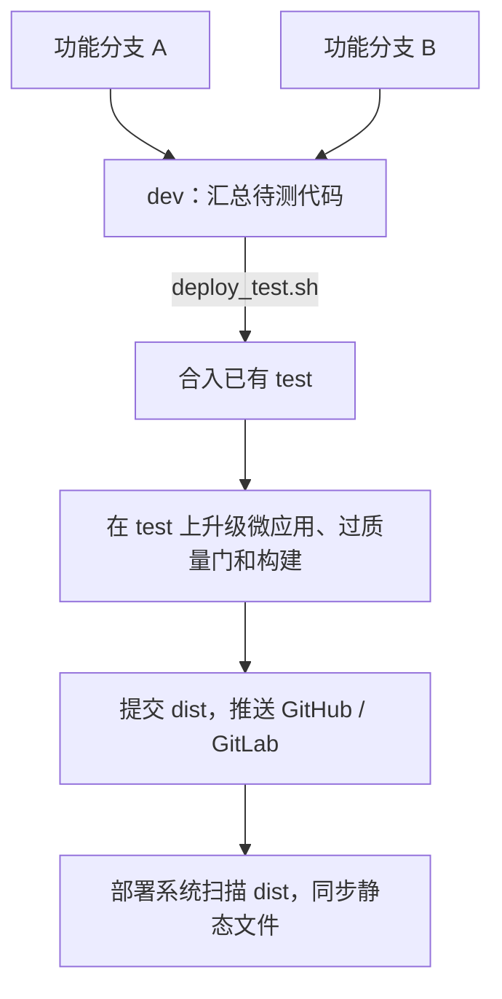
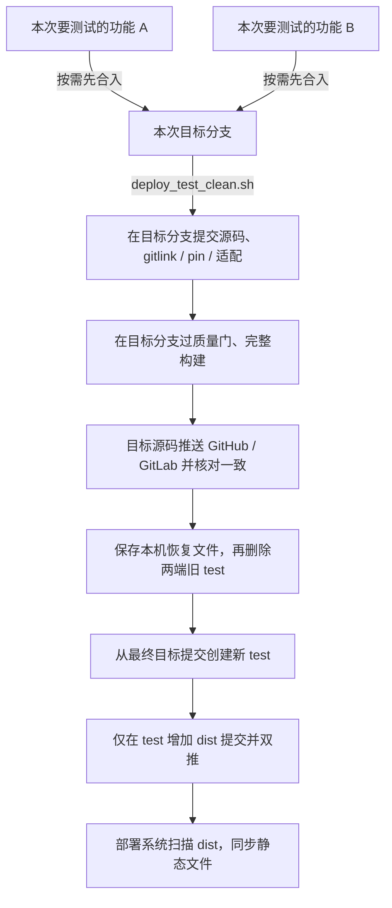

# 提测部署 Runbook（面向人，无需 AI/agent）

> 一条命令 + 一张自助表。任何人在仓库根目录都能跑，不依赖 agent 陪跑。

## 当前提测流程：使用新入口

日常提测统一使用 `deploy_test_clean.sh`。**新流程不需要 dev 作为中转分支，也不修改或推送 dev**；直接以本次选定的目标分支提测。旧 `deploy_test.sh` 和全链脚本暂时保留兼容。

| 对比项 | 旧流程：`deploy_test.sh` | 新流程：`deploy_test_clean.sh` |
| --- | --- | --- |
| 提测准备 | 先将自己的 feature 分支合入 dev，再运行旧脚本 | 切到本次要测试的 feature、版本或 release 分支，直接运行新脚本；也可显式指定目标分支 |
| 源码路径 | 汇合双远端 dev，再合入已有 test，已有 test 中的功能可能继续保留 | 只汇合同名目标分支的双远端提交，从最终目标提交重建 test，不合入 dev 或旧 test |
| 源码准备与构建 | 在组合后的 test 上升级微应用、过质量门和构建 | 在目标分支提交全部非 dist 改动、升级微应用并提交 gitlink/pin/适配，过质量门和完整构建 |
| 产物归属 | dist 随 test 提交、推送 | 目标分支不新增 dist 产物提交；新 test 在目标源码基础上只增加 dist 提交 |
| test 更新方式 | 沿用已有 test 的历史并合并 | 构建和目标源码双推成功后，将旧 test 写入本机恢复文件，再删除 GitLab/GitHub 旧 test，创建并双推同名新 test；不创建 backup 分支 |

### 旧流程图：功能先汇总到 dev



### 新流程图：目标分支直接提测



单个功能可以直接用该功能分支作为目标分支，无需额外建立汇总分支；多个功能一起测试时，先手动合入本次目标分支。新脚本不负责挑选或合并不同功能分支，也不要求先合入 dev。

最常用的操作是在自己的目标分支运行：

```bash
bash deploy_test_clean.sh
```

脚本会自动提交目标分支全部非 dist 改动，包括已有业务修改，运行前请确认这些代码都要进入本次提测。要同时测试多个功能，先把它们合入选定的目标分支；目标分支本身已包含的功能不会被自动拆除。测试环境仍由现有部署系统扫描 test 分支的 dist 并同步静态文件，流程不涉及 K8S。

## 临时 test 通道：从指定分支重建

新入口与旧脚本并存，日常提测使用以下命令：

```bash
bash deploy_test_clean.sh                    # 使用当前分支
bash deploy_test_clean.sh feat-2026.11
DRY_RUN=1 bash deploy_test_clean.sh          # 演练当前分支
```

目标分支可省略，默认使用运行脚本时当前检出的本地分支；显式指定时，可以是本地分支，或双远端至少一侧存在的同名分支。当前分支为 test 或处于 detached HEAD 时不能按当前分支部署，需先切换到目标本地分支。脚本只汇合同名目标分支，不级联合入版本分支、dev 或旧 test。当前在其他分支且有未提交代码、子模块内部有文件修改、Git 操作未完成或 test 被其他 worktree 占用时停止。目标分支本身已混入的功能不会被自动拆除。

1. fetch 双远端，固定本轮输入；浅克隆会先从 origin 补齐历史，以保证本机恢复文件包含完整 Git 对象，补齐失败则停止。目标分支的**全部非 dist 改动（包括已有业务改动、新文件与删除）会自动提交**，已暂存的 dist 也会排除。合并同名双远端目标分支，源码冲突回滚停止。
2. 在目标分支升级微应用、提交 gitlink/pin/适配和版本常量，运行会话质量门及 `build:prod:m`。不提供跳过质量门选项。构建若又修改非 dist 文件，先提交到目标分支，再过门、重建一次；再次变化则停止。目标分支不新增 dist 产物提交，也不会自动提交子项目内部源码。
3. 将最终目标提交普通推送到 GitHub、GitLab，回读确认同一 HEAD。构建后不使用合并自愈；远端出现并发更新即停止，重新汇合源码后必须重新构建。
4. 构建和目标分支双推成功后，将 GitHub、GitLab、本地旧 test 的提交与完整 Git 对象保存到本轮目录的 `test-rollback.bundle`，核验成功后才允许删除旧 test；不存在的旧分支跳过。核对远端未变后，依次删除 GitLab、GitHub 旧 test。不创建或推送任何 backup 分支。
5. 从最终目标提交新建 test，只增加完整 dist 的产物提交，普通双推并回读确认相同 HEAD。成功后切回目标分支；环境部署仍由现有扫描系统执行。

新入口完成后核对以下两组提交，dev 不参与本次提测：

```text
origin/<目标分支> / gitlab/<目标分支> → 相同源码 SHA
origin/test / gitlab/test → 相同产物 SHA（父提交为最终目标源码）
```

哈希资源仍保留默认 3 代；上一版 dist 取自删除前的 GitLab/test，CSS 历史回填通过 `DIST_RETENTION_HISTORY_REF` 指向该旧提交。每轮重建都从同一份旧产物快照开始，避免重建两次使资源提前过期。M 端沿用下文的来源选择及 `MOBILE_BUILD_REPO` / `MOBILE_BUILD_BRANCH` 覆写。

### 失败恢复

运行记录在 Git 公共目录的 `nuwax-deploy/clean-<时间>-<随机编号>/state`。同事只需使用目标分支和 test，**不需要切换任何 backup 分支**。恢复文件仅存于执行提测的本机，不推送到远端：

- 成功后原子替换 Git 公共目录下的 `nuwax-deploy/test-rollback.bundle`，仅保留最近一份常规恢复文件；文件内分别记录 origin/gitlab/local 的旧提交，不要求三端原先一致。
- 失败时保留本轮目录里的 bundle、原 dist、本轮产物、当前分支和源码，不覆盖上一份常规恢复文件。失败运行的文件供恢复使用，不自动清理。
- 恢复时先执行日志给出的 `git bundle unbundle <文件路径>` 导入 Git 对象，再按日志的精确旧 SHA 补推缺失的 test。`git bundle list-heads <文件路径>` 可查看文件内的旧提交，无需检出备份分支。

脚本按本轮精确提交打印源码补推、产物补推及旧版本恢复命令。不要合并旧 test 来修复推送失败。

- 质量门、构建或目标分支推送失败：旧远端 test 不删除。
- 本机恢复文件创建或核验失败：旧远端 test 不删除。
- 删除权限不足、单端成功或网络失败：不算完成；先核对两端现状。分支已缺失时可先导入本轮恢复文件，再用打印出的旧 SHA 普通推送恢复；已有新提交则先协调，禁止强推。
- 新 test 只有一端发布成功：核对未发布端仍缺失后，按打印命令补推同一个产物 SHA。若决定重新构建，也须先核对并处理这轮部分发布状态。

两端仓库无法跨库原子替换，删除到重建之间 test 会短暂不存在；执行期间应暂停其他提测脚本和人工对 test 的更新。脚本使用本地运行锁并在远端操作前后核对 SHA，但不能阻止其他机器同时写入。异常终止留下 `nuwax-deploy/clean-test.lock` 时，确认没有本轮进程后再移除锁；不自动删除未知进程的锁。历史版本生成的 `backup/test/*` 分支可在归档、核验后清理，新入口不再生成它们。

## 旧入口：快速通道与全链

以下两条通道保留兼容原来的 dev → test 流程；当前日常提测使用上文的新入口。

|  | 快速通道 `bash deploy_test.sh` | 全链 `bash scripts/deploy_sync_test.sh` |
| --- | --- | --- |
| 什么时候用 | 代码已经在 dev（origin 或 gitlab 任一侧），只想尽快出一版测试环境 | 从个人分支出发，要一路合进版本分支、dev、test |
| 合并路径 | 本地 dev 汇合 origin/dev + gitlab/dev → test | 个人分支 → 版本分支（双远端）→ 本地 dev → test |
| 推送 | dev/test 均推 origin+gitlab | 个人/版本/dev/test 均推 origin+gitlab |
| 远端 dev | 汇合后双推送 | 组合质量门通过后双推送 |
| test:conversation 质量门 | **默认跑**；源码与已部署的 gitlab/test 相同则跳过；同一提交成功过不重跑；`GATE=0` 紧急绕过 | 默认跑（个人分支 + 组合 dev / test 各一道，同样有跳过与缓存） |
| 子模块（repo-web / im） | **自动升级到远端 main 最新**，适配预检通过后提交 gitlink/pin，再过门和构建；子模块缺失或升级失败即停止（内部链 `MICRO_APP_REQUIRED=1`） | 步骤 2.5 自动升级到远端 main（`UPGRADE_MICRO_APPS=0` 关闭） |
| M 端产物（dist/m） | 本地 nuwax-mobile 检出的 origin 远端（`MOBILE_BUILD_REPO` 可覆写） | 同左 |
| 源码冲突 | 微应用 pin/gitlink 不一致时对齐子模块远端最新并继续；其它源码冲突打印清单 → 回滚 → 退出，不构建不推送 | 同左 |
| 工作区不干净 | 仅子模块检出版本与登记不同自动对齐并继续；主仓/子仓文件改动或已暂存输入仍拒绝（需要隔离请走全链） | 自动转入独立 worktree |
| 演练 | `DRY_RUN=1` | `DRY_RUN=1` |

两条通道共用 `scripts/deploy/lib.sh` 里的合并、冲突消化、推送自愈和质量门函数，规则只维护一份。同事克隆的三类常见差异都会自愈：没配 `gitlab` 远端时自动补配（内网测试环境落点，`GITLAB_REMOTE_URL` 可覆写地址）；单分支检出缺本地 `dev`/`test`（全链含版本分支）时从远端自动补建，个人分支（提测输入）仍要求本地存在；M 端产物源见下节。2026-10-14 前缺 gitlab 远端会在第一步 fetch 被当网络错误空耗重试后中止。

### 快速通道的三条决策（2026-11-04 更新）

本节维护当前规则；初版方案中的未完成后续项见 [快速通道计划](../plans/20261014-deploy-test-fast-lane-plan.md)，已完成的调整过程通过 Git 查询。

1. **质量门默认开启。** 同事直接推到 gitlab/dev 的提交可能尚未验证，快速通道负责检查真正交付的组合源码。终端只打印测试汇总与耗时，详细输出保存在 Git 公共目录的 `nuwax-deploy/gate-last.log`；失败展示日志尾部并保留 `gate-failure.log`。输入未变或同一提交已成功时复用结果。紧急情况用 `GATE=0`，脚本会大字提示本次未经门禁。
2. **自动更新子模块到最新。** 2026-10-15 按用户要求替代原来的「只提醒不升级」规则。起跑时只要子仓没有文件改动，未暂存的提交指针偏差就自动对齐；汇合到 test 后执行 `npm run upgrade:micro-apps -- all`，通过快进及 patch/overlay 预检后提交 gitlink 与 adapter.pin，再过质量门和构建。实际文件改动、已暂存输入、网络失败或适配冲突仍停止并保留现场，不静默退回旧版本发布。
3. **所有提交和合并均双推送。** 2026-11-02 起，origin 固定为 GitHub、gitlab 为内网；个人、版本、dev、test 分支都同步到两端。第二端并发更新触发合并时，必须把合并结果回推第一端，并回读核对相同 HEAD；任一失败不算交付完成。

### M 端产物源：跟着本地 nuwax-mobile 的 origin 走

npm 会把附加参数接到复合命令的最后一段（`deploy-asset-retention.mjs merge`），传不到 M 端下载脚本。2026-10-14 起，下载脚本不再配置 GitLab/GitHub 地址，解析顺序为：**本地 nuwax-mobile 检出的 origin 远端 > GitHub 的 nuwax-mobile 仓库**。前者跟着各机器的本地 git 配置走（origin 指向 GitHub 还是内网 GitLab 都行，M 端后续会默认同步到 GitLab）；本地没有该检出（普通用户打本包的常态）时回退 GitHub 地址并打印警告。需要临时覆写用环境变量：

```bash
MOBILE_BUILD_REPO=<仓库地址> npm run build:prod:m
```

M 端默认分支为 `feat-2026.11`，不会跟随前端当前分支或目标分支名；`MOBILE_BUILD_BRANCH` 可覆盖。`npm run build:prod:m` 构建 PC 前端后，下载 M 端所选分支已提交的 `unpackage/dist/build/web` 到 `dist/m`，不会在此重新编译 M 端源码。M 端源码更新后，需先在 nuwax-mobile 完成 H5 构建，并将产物提交、推送到所选分支，再运行前端提测。

```bash
# 前端使用 release 分支，M 端沿用默认 feat-2026.11 产物
bash deploy_test_clean.sh release-2026.11.05

# 按需指定 M 端分支；不改变前端目标分支的选取规则
MOBILE_BUILD_BRANCH=<M端分支名> bash deploy_test_clean.sh release-2026.11.05
```

构建日志会打印实际使用的来源、分支与拉到的 M 端提交号。

## 怎么跑（旧全链）

```bash
bash scripts/deploy_sync_test.sh
```

- 首次运行交互生成配置（`scripts/deploy_sync_test.env`，之后免输入）
- 总耗时受构建缓存和网络影响，以本次输出为准
- `DRY_RUN=1` 演练不执行写操作；`INIT_ONLY=1` 只生成配置

## 旧入口自动处理

| 场景 | 脚本行为 |
| --- | --- |
| 主区有未提交代码（并行开发/构建现场） | 自动转入 `.nuwax-deploy-worktree` 隔离跑全链，主区零接触 |
| 子模块（nuwax-im / repo-web）远端 main 领先 | 两条通道均走 `upgrade:micro-apps` 正规通道，适配预检通过后升级并提交；快速通道在组合 test 过门前执行 |
| 快速通道起跑时子模块检出版本偏离登记 | 无文件改动时自动对齐后继续；子仓文件改动或已暂存输入仍保护并报错 |
| 网络抖动（SSL 瞬断 / fetch 断） | 自动退避重试（10s/20s × 3），不要手工重启 |
| dist 构建产物冲突 / version.ts 烤哈希冲突 | 机器产物自动消化（dist 清空重建 / version.ts 取本地侧） |
| test 远端分叉 pull 撞冲突 | 自动按机器产物自愈提交合并 |
| 微应用 gitlink/pin 配对撕裂（合并无感撕裂） | 自动以 gitlink 为准修齐 pin |
| 合并时两侧微应用 pin / gitlink 不一致 | 不取 ours/theirs，fetch 子模块 `origin/<branch>` 最新提交并同时改 gitlink 与 adapter.pin；adapter 还有 pin 以外的字段冲突则仍回滚 |
| test:conversation 失败全是「Test timed out」 | 等 15 秒重试一次（`GATE_JITTER_RETRIES`、`GATE_JITTER_BACKOFF` 可调）。断言失败不重试 |
| 上次异常退出残留（index 幽灵 unmerged / worktree 占用分支） | 前置自动清理 |
| 断点续跑 | 中途修完问题**直接重跑同一命令**，已过步骤自动跳过（质量门不重付） |
| test 组合源码与已测 dev 不同 | 步骤 7.1 自动补过质量门（只改机器产物时不重复跑） |

## 旧入口会停下来的三种情况

### 1. 质量门挂（test:conversation 有失败套件）

质量门失败会阻断提测，终端展示最后 80 行并打印完整日志路径；不支持按失败套件名豁免。按日志中的 `FAIL` 文件路径隔离复跑：

```bash
pnpm exec vitest run <测试文件路径>
```

- **隔离复跑也挂** = 真回归。九成是「最近合入的接口契约变了没同步测试断言」（改端点/参数/鉴权方式）：对照失败输出里的期望值 vs 实际值，`git log -S '关键字'` 找到改契约的提交，把断言跟上新契约。
- **隔离复跑通过** = 机器负载抖动。失败原因若全是用例超时，脚本会自动再跑一轮；仍失败再重跑本脚本。

### 2. 源码 merge 冲突

脚本回滚并打印**需人工取舍的冲突文件清单**（机器产物已自动消化）。处理：

```bash
git merge origin/feat-2026.9.30   # 按清单提示的分支重演冲突
# 逐文件按双方语义取舍（🔴勿用 checkout --ours/--theirs 整文件取侧，会静默丢对方功能）
git commit && bash scripts/deploy_sync_test.sh   # 断点续跑
```

### 3. 微应用适配 patch 冲突（子模块 main 前进但适配没跟上）

报错自带**冲突文件清单 + 上游前进范围**。处置归属：微应用适配负责人基于新候选重制 `adapter.json` 指向的 `adapter.patch`，随构建提交；**其他同事拉最新分支重跑即可，无需本地处理**。

## 旧入口完成后（核对两个远端）

脚本末尾自动打印两个远端的分支落点；每个对应分支的 HEAD 必须一致：

```
origin/<版本分支> / gitlab/<版本分支> → 相同 SHA
origin/dev / gitlab/dev → 相同 SHA
origin/test / gitlab/test → 相同产物 SHA
```

## 旧入口约定

1. 主区不干净自动进 worktree，不要手工清场
2. `src/constants/version.ts` 只存 APP_VERSION / APP_NAME；提交哈希运行时读取 `dist/version.json`，不烤入源码
3. 网络抖动等脚本自愈，勿手工重启整链

## 旧入口遗留告警

- `gitlab/dev 存在 N 个独有提交`：先汇合双方历史，之后将组合 dev 同步到两个远端。
- `构建产物无变更，跳过提交`：本轮无代码变化，推送为 no-op，正常

社区打包遇到未初始化的私有子模块会警告并跳过相应微应用；内部提测链设置 `MICRO_APP_REQUIRED=1`，缺失时停止。
