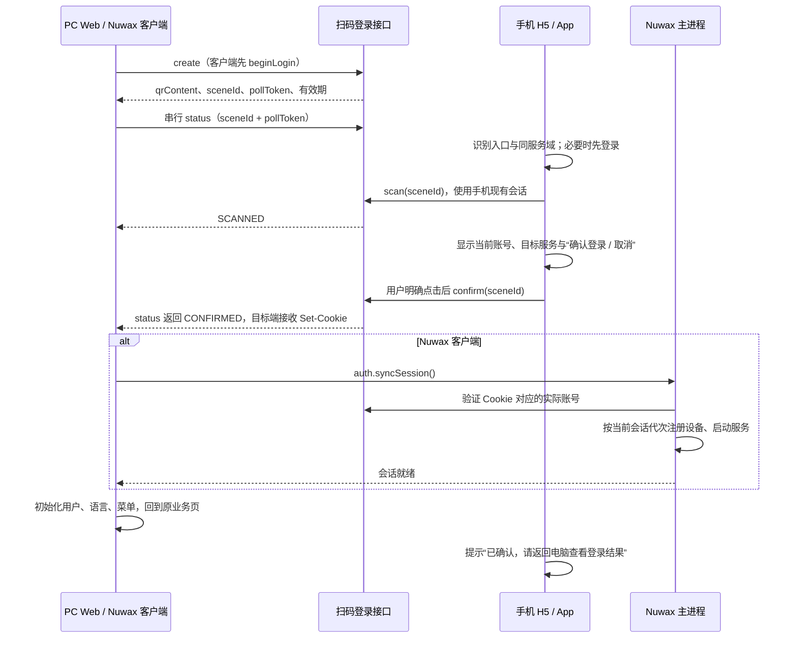

# 计划：扫码登录全链路（下一版本）

## 目标与决定

- 本功能属于**下一版本交付内容**，PC Web 和移动端 PR 目标仍为 `feat-2026.11`，客户端为 `release/v3.1.0`。三端候选分别提交评审；跨端集成和联合验收由版本交付安排。
- 开发基于 `dev`（`e48b25394d5364ab8d8377fb4b71e7ce5a1c0f14`），分支 `codex/qr-code-login`。需求来源：[11 月规划 L7 / H3](https://agent.nuwax.com/repo/doc/fE9VALiLLvThNueV)。范围覆盖 PC Web、Nuwax 桌面客户端 `nuwax-client`、`nuwax-mobile` 的浏览器 H5 与原生 App。

| 端 | 角色与入口 | 完成后的会话 |
| --- | --- | --- |
| PC Web | 登录页选择“扫码登录”，展示二维码并等待手机确认 | 后端写入当前浏览器 Cookie，初始化用户、语言、菜单并返回业务深链 |
| Nuwax 客户端 | 同一登录页展示二维码；企业服务使用客户端当前配置的业务域 | 主进程接收业务 Cookie，`auth.syncSession()` 验证账号后由 AuthLifecycle 注册设备、启动服务 |
| 移动 H5 | 系统相机/微信等扫描网址后进入 M 站确认页；未登录先完成 H5 登录 | 使用手机浏览器自己的 Cookie 授权目标端，不向目标端传手机 Token |
| 移动 App | 现有“扫一扫”识别登录码，或用户从 H5 点击“在 App 中打开” | 使用 App 既有登录态提交扫码与确认，App 本身不切换成目标端会话 |

手机的默认登录页保留已有登录方式；本流程中手机负责确认另一端登录。App 内嵌 H5 的登录前置交给原生宿主，不能建立与原生账号脱节的第二套会话。

## 当前依据与实现边界

- [现有接口](https://test-nvwa-api.xspaceagi.com/doc.html#/default/扫码登录/create_7)：`POST /api/user/qrcode/create` 返回 `sceneId/pollToken/qrContent/expireSeconds`；`GET /api/user/qrcode/status` 需要 `sceneId + pollToken`，状态只有 `WAITING / SCANNED / CONFIRMED / EXPIRED`。`POST /api/user/qrcode/scan/{sceneId}` 和 `POST /api/user/qrcode/confirm/{sceneId}` 需要手机登录态，后者须扫码用户本人操作。成功业务码为 `0000`。
- 测试环境实际返回的二维码是 `https://{业务域}/qrlogin/{sceneId}`。`qrContent` 由后端生成，目标端原样编码；`pollToken` 只保存在发起面板内存，绝不进入二维码、跳转参数、日志或移动端。
- 本 PR 已实现 `src/services/qrLogin.ts`、登录页扫码面板及回归测试；确认后复用既有登录收尾。普通线上浏览器与商业桌面壳走 Cookie，本地普通浏览器开发模式单独取回调试 Token。
- `nuwax-client` 的实际壳入口为 `nuwa-electron-shell/crates/agent-electron-client/`。[客户端 PR #87](https://github.com/nuwax-ai/nuwax-client/pull/87) 将二维码创建/状态查询纳入匿名登录签发分类，复用 `auth:beginLogin` / `auth:syncSession` 和 Cookie 镜像；网关依赖此分类隔离旧 ticket 并推进登录代次，手机 scan/confirm 仍保留鉴权。客户端候选目标为 `release/v3.1.0`，当前消费 pin 尚未包含扫码界面，下一版本集成时需同时消费两端改动。
- [移动端 PR #20](https://github.com/nuwax-ai/nuwax-mobile/pull/20) 新增确认页、scan/confirm 请求封装、扫一扫登录码分发以及冷/热启动 scheme 续接。登录前置复用 `utils/authNavigation.uts`，认证模型以 `utils/authSession.uts` 为准：生产浏览器 H5 用 Cookie，原生 App / App 内嵌 H5 用现有 Bearer。普通 H5 浏览器仍由外部相机打开链接，本次没有开放网页内相机识码。
- Android/iOS manifest 已声明 `nuwax` scheme，本次新增其扫码登录消费逻辑；原生平台的实际唤起和鸿蒙能力仍待版本集成验证。源码候选不等于已上线，未更新当前交付的源码或产物 pin。

## 端到端流程

手机 confirm 成功只证明已授权，不能据此声称目标端菜单、设备注册和服务启动全部完成。目标端仍可能在 Cookie 同步或初始化阶段失败，并应提供重试。

### 路由与登录续接

以下确认页和 scheme 已在源码候选中注册，尚未合并或上线。

| 场景 | 落点与动作 |
| --- | --- |
| 统一二维码 | 保留后端 `https://{业务域}/qrlogin/{sceneId}`，不另造携带登录 Token 的码 |
| App 内扫一扫 | 在普通 URL 分发之前识别同服务域 `/qrlogin/:sceneId`，进入 `/subpackages/pages/qr-login/qr-login?sceneId=…&origin=…` |
| 系统相机/外部浏览器 | `/qrlogin/:sceneId` 转为同源 `/m/#/subpackages/pages/qr-login/qr-login?sceneId=…`；站点须保证该入口可达，避免先落入 PC 404 或普通移动首页 |
| H5 打开 App | 用户明确点击后尝试 `nuwax://qrlogin?sceneId=…&origin=…`；失败或未安装时保留 H5 确认和下载入口，不自动无限唤起 |
| App 冷/热启动 | 启动页、`onShow` 统一消费明确的扫码意图，未登录先走现有带协议勾选的登录页，再返回确认页；普通回前台不重放旧唤起参数 |
| 未登录或会话失效 | `redirect` / `authReturnUrl` 保留同源确认页和 `sceneId`；完成密码、验证码或服务端配置的联合登录后回确认页，重新校验二维码，不自动提交 confirm |

`sceneId` 为不透明字符串，只校验长度、字符与单路径段边界，并在请求路径中编码；不套用名片 userId 的纯数字规则。二维码服务 origin 必须与 App 当前配置或 H5 当前业务 origin 精确匹配，拒绝伪造域、带凭据地址和跨环境码；不能凭扫码参数静默切企业域、自动登录外站或向二维码给定地址发送手机凭据。

登录跨页面需要续接时，只短期保存服务 origin、sceneId 与入口上下文；不保存“已点击确认”的意图。完成、取消或换服务域后清理。二维码是否仍有效由服务端重新校验，不把固定的本地倒计时当成授权依据。

### 移动确认页

1. 校验服务域和 sceneId，取得当前账号。App 缺登录态先去原生登录；生产 H5 通过实际接口确认 Cookie，不能因 HttpOnly Cookie 在 JS 中不可见就判未登录。
2. 请求 `scan`，成功后展示“登录 Nuwax 网页/客户端”、目标服务域、当前账号（昵称及脱敏账号）、“确认登录”和“取消”。若没有服务端目标端元数据，只展示已知服务域和通用端名称，不能猜测设备名、IP 或目标端类型。
3. 只有本页当前账号下的明确点击才发 `confirm`。请求期间禁用重复点击；刷新、返回、从后台恢复、登录成功和错误重试都不得自动授权。切账号或换域使旧页面代次失效，必须重新扫码校验。
4. confirm 成功进入只读结果页，提供“完成”返回入口，不把目标端 Token 写入手机。失败留在当前场景给出可重试提示；若登录过期，先重登回页，再由用户重新确认。
5. H5 主要承接系统相机/外部扫码的网址结果，本期不假设 `uni.scanCode` 在普通 H5 浏览器可用。若后续增加 H5 页面内相机识码，需单独验证 HTTPS、权限、浏览器/微信能力及相册降级，不能把原生条件编译分支直接开放。

### 取消、刷新、过期和失败

| 情况 | 目标端 | 手机端 |
| --- | --- | --- |
| 未扫码 | 显示二维码和使用说明；只在上一请求结束后排下一次轮询 | 尚未打开确认页 |
| 已扫码 | 提示等待手机确认；需提供“重新生成二维码”以放弃本轮 | 展示明确确认按钮 |
| 用户取消/返回 | 现有接口没有取消状态；仍等待至过期或由用户重新生成，不能伪造“已取消” | 不发 confirm，退出并提示“未授权登录” |
| 二维码过期 | 停止轮询、隐藏旧码、提供刷新 | scan/confirm 的服务端失效结果提示回电脑刷新，不继续提交 |
| 目标端刷新/离开 | 取消旧请求和计时器，旧响应不能再次触发 UI 登录收尾 | 旧场景可能仍在服务端有效；不能承诺已经撤销它 |
| 断网/接口失败 | 停止当前轮询，提示刷新重试，不触发全局未处理拒绝 | 保留确认上下文并允许重试；重新校验有效期和当前账号 |
| 另一账号扫码、跨租户或跨服务域 | 旧请求不覆盖新一轮状态 | 明确提示使用对应账号/服务重新扫码，不自动切账号或域 |
| 确认后目标会话同步失败 | 显示登录失败及重新扫码入口，不能先跳主页或另起 renderer 注册链 | 结果页提示回电脑查看结果 |

只取消 HTTP 请求不等于服务端撤销场景。若产品要求“手机取消立即通知电脑”或“电脑刷新后旧码立即作废”，需后端增加取消/撤销契约及相应终态，再扩展两端状态机；现有四状态 API 不具备这个保证。

## 实施与验证

- 共享前端：已实现协议确认、二维码生成、串行轮询、有效期、失败重试、登录收尾，以及已扫码时主动重新生成。换码点击时立即取消旧请求并使迟到确认失效；`/qrlogin/:sceneId` 首屏分流及匿名路由兜底将手机带到同源 M 站确认页，丢弃额外的 origin、pollToken 和 redirect。
- 客户端：匿名登录签发分类候选见 PR #87；直连与 loopback 复用现有 Cookie 和主进程 commercialAuth / AuthLifecycle，不在网页注册设备。源码及产物 pin 按下一版本整体更新，安装包通过 GitHub Actions 验收。
- 移动端：已封装 scan/confirm、注册确认页并扩展扫一扫、H5 登录返回及原生冷/热启动分发。确认前再次读取实际账号，换账号/服务域或页面离开后忽略旧响应；双击仅提交一次，确认超时或后台恢复只提示查看电脑并重新校验。H5 提供用户主动打开 App 和下载入口，App 内嵌 H5 使用现有受信导航/原生登录交接，不自动确认。
- 开发自检：移动端 137 项相关回归、i18n 审计及 HBuilderX Android 代码编译通过；网页承接及二维码相关 35 项回归、改动路径 ESLint/Prettier 通过。M 站首屏脚本保留扫码确认及其登录返回，不受平板桌面模式的通用 PC 分流影响。H5 使用 HBuilderX 内置编译器构建。真机、安装包及发布验收由团队执行，本次不发版。
- 接口待联调：scan 的重复进入/同一扫码者重试、confirm 的重复点击/超时重试是否幂等；跨账号/跨租户/过期的业务码；二维码结果被目标端领取一次还是可重试。需要显示精准设备信息时还须后端提供受信目标端元数据与有效期，当前 create 无此入参，scan 返回也没有上下文详情。上述新增契约由后端负责人确认，本任务不修改 `agent-platform`。

验收按真实消费者覆盖：

| 组合 | 必须覆盖的证据 |
| --- | --- |
| PC Web × 已登录 App | 真机相机扫码、确认、目标端 Cookie 登录与业务深链 |
| Nuwax 客户端 × App | macOS/Windows 安装包，直连/loopback，企业域、首登注册与服务启动、换账号和旧响应隔离 |
| PC Web / 客户端 × H5 | 系统相机或微信打开 M 站，已有 Cookie / 未登录 / 服务端联合登录后续接，明确点击后才授权 |
| App 深链 | Android/iOS 冷启动、热启动、未安装回退；鸿蒙支持能力与缺省降级单列验证 |
| 失败路径 | 过期、取消、重复扫码、确认超时重试、账号/租户/服务域不一致、电脑刷新、页面离开与后台恢复 |

## 未完成事项

- 三端候选尚未合并、集成或更新客户端消费 pin；下一版本需同时消费共享登录页、客户端 PR #87 和移动端确认页。
- 后端幂等/领取语义、取消撤销和目标端元数据按上文逐项确认；未确认的新增契约不预先调用。
- App 真机、H5 外部扫码全链路、iOS/鸿蒙唤起与商业桌面安装包仍待团队联合验收；开发自检不替代这些证据。
